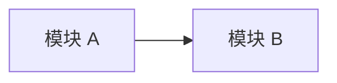

+++
title = '{{ replace .Name "-" " " | title }}'
date = {{ .Date }}
lastmod = {{ .Date }}
draft = true
slug = '{{ .Name }}'
description = ''
categories = []
tags = []
series = []
series_title = ''
series_order = 10
math = false
toc = true
comments = true
keywords = []
+++

## TL;DR

用 3 到 5 句话说明这篇文章解决什么问题、适合谁、结论是什么。

## 背景与问题

说明协议 / 模块出现的场景、约束和要解决的核心问题。

## 架构与数据流



## 时序与协议行为


{
  "signal": [
    {"name": "clk", "wave": "p......."},
    {"name": "valid", "wave": "0.1....0"},
    {"name": "ready", "wave": "0..1..0."}
  ],
  "config": {"hscale": 2}
}


## 关键设计要点

- 参数化位宽、深度、吞吐能力。
- 握手与反压路径。
- 跨时钟域 / 复位策略。
- 面积、时序、功耗权衡。

## 验证要点

### SVA 断言

```systemverilog
property p_handshake;
  @(posedge clk) disable iff (!rst_n)
  valid && !ready |=> valid;
endproperty
```

### 覆盖率

- 功能覆盖率：边界、错误、背压场景。
- 断言覆盖率：协议规则、握手、错误响应。
- 代码覆盖率：分支、条件、FSM 状态。

## 常见坑

- 列出真实调试中容易踩的问题。

## 参考规范

- 相关协议规范 / IP 手册 / 论文。

## 相关文章

由 Stack 的 related content 和系列导航自动生成；也可以手动补充。
