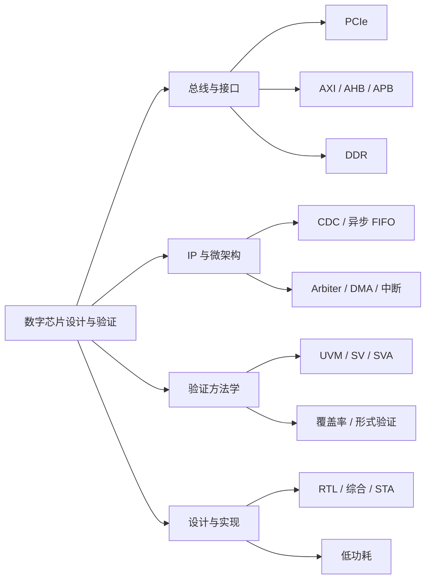

+++
title = "知识地图"
description = "按主题浏览知识库中的文章与系列"
slug = "knowledge-map"

[menu.main]
  weight = -90

  [menu.main.params]
    icon = "categories"

[build]
  list = "never"
+++

## 知识地图

这个页面按主题汇总知识库中的文章。内容会随着学习进度逐步补充。

### 按主题进入

| 主题 | 入口 | 相关系列 |
| --- | --- | --- |
| 总线与接口 | [分类页]() | `pcie-from-scratch`、`axi4-deep-dive` |
| IP 与微架构 | [分类页]() | `cdc-handbook` |
| 验证方法学 | [分类页]() | `uvm-in-practice` |
| 设计与实现 | [分类页]() | `sta-notes` |
| 全部系列 | [系列页]() | — |

### 当前文章

- [PCIe 协议入门：从分层架构到链路训练]()

> 分类页和系列页会随文章增加自动生成。建议从“学习路线”或“PCIe 从零开始”系列开始。
