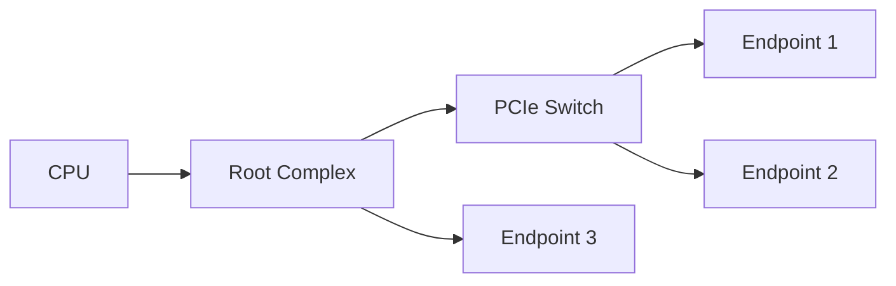
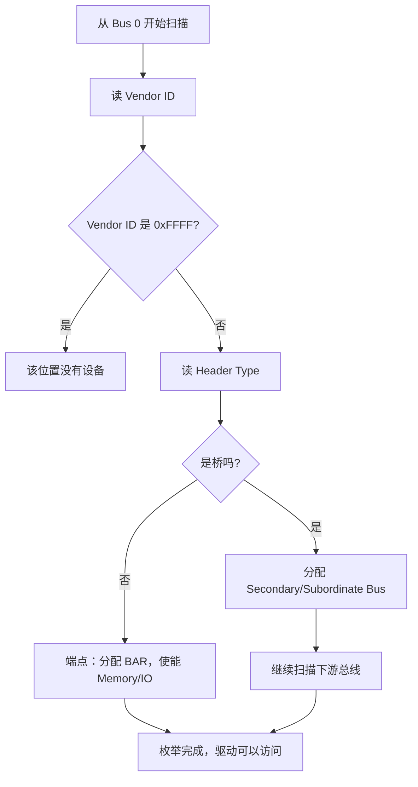
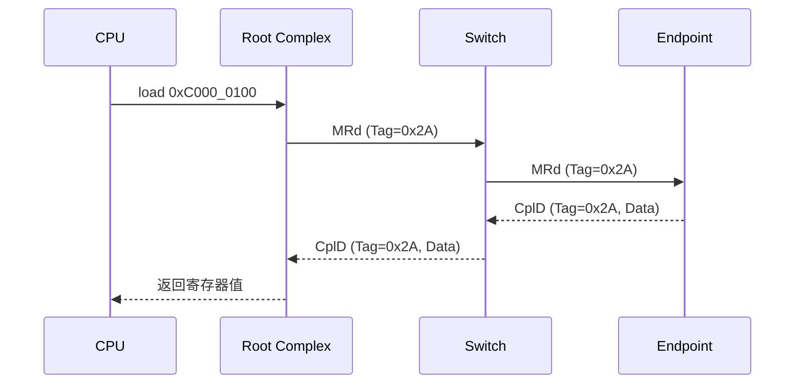
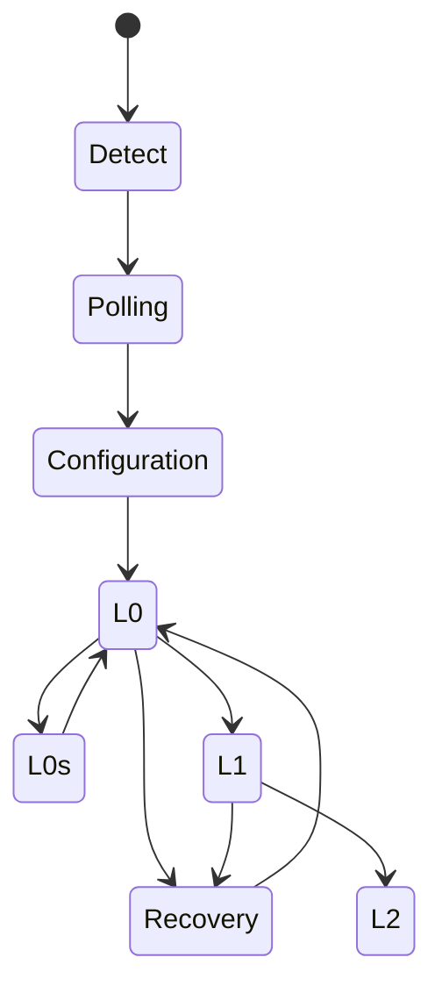

+++
title = "PCIe 协议入门：从一次内存访问看懂分层、TLP 与链路训练"
date = 2026-11-04
lastmod = 2026-11-04
draft = false
slug = "pcie-intro"
description = "写给第一次接触 PCIe 的人：用一次 MMIO 读访问串起拓扑、枚举、TLP、分层、LTSSM、流控和验证要点"
categories = ["总线与接口"]
tags = ["pcie", "tlp", "ltssm", "configuration-space", "enumeration"]
series = ["pcie-from-scratch"]
series_title = "PCIe 从零开始"
series_order = 10
math = true
toc = true
comments = true
keywords = ["PCIe", "TLP", "LTSSM", "配置空间", "BAR", "枚举", "流控"]
+++

## 写在前面：这篇文章怎么读

如果你没做过 PCIe，第一次看规范很容易被 TLP、DLLP、LTSSM、BAR、Credit 这些缩写淹没。这篇文章不追求把规范讲全，而是先帮你建立一张**能用的地图**：

- PCIe 到底在系统里连接了什么？
- 设备上电后，系统怎么发现它、给它分配地址？
- 驱动读一个寄存器时，数据是怎么从 CPU 走到设备再走回来的？
- 分层、链路训练、流控、错误处理分别在解决什么问题？
- 设计和验证时，应该重点关注什么？

建议分三遍读：

1. **第一遍**：只看 TL;DR、“快递系统”类比和“一次 MMIO 读”，建立直觉。
2. **第二遍**：看枚举、分层、TLP 和 LTSSM，把流程串起来。
3. **第三遍**：看设计、验证和自测题；需要细节时再展开 `<details>` 里的内容。

> 本文用一个假想的网卡作为例子：BDF 为 `01:00.0`，BAR0 是一段 4 KB 的 64 位 Memory 空间，系统分配基地址 `0xC000_0000`。地址和 BDF 都是示意，实际值由枚举决定。

## TL;DR：先用 5 句话认识 PCIe

1. PCIe 是 CPU 和设备之间的**高速串行互连**，每条 Link 是**点对点**的，不是 PCI 那种共享总线。
2. 数据以 **TLP（Transaction Layer Packet）** 为单位传输，经过 **Transaction / Data Link / Physical** 三层。
3. 设备上电后要先**枚举**：分配 BDF（Bus/Device/Function）和 BAR（地址窗口），驱动才能访问它。
4. 驱动读寄存器，本质是发一个 **Memory Read（MRd）**，设备返回 **Completion with Data（CplD）**；写寄存器通常是 **Memory Write（MWr）**，发出去就结束，不等回复。
5. 链路要先训练到 **L0** 才能传 TLP；出问题就看 **LTSSM、流控 Credit、AER 错误报告**。

<!--more-->

## 一个类比：把 PCIe 想成快递系统

先不要记缩写，先用快递系统建立直觉：

| PCIe 概念 | 快递类比 | 它在解决什么 |
| --- | --- | --- |
| Endpoint / Function | 收件人 | 最终处理请求的设备或功能 |
| BDF | 收件人的编号 | 系统如何找到某个设备功能 |
| BAR | 收件人的门牌号范围 | 设备向系统申请的一段地址窗口 |
| TLP | 包裹 | 一次事务的完整数据单元 |
| TLP Header | 面单 | 寄给谁、寄什么、多长、怎么回 |
| Completion | 回执 | 读请求的返回数据或状态 |
| Transaction Layer | 决定寄什么、寄给谁 | 组装/解析 TLP、路由、Tag、流控 |
| Data Link Layer | 快递单号和丢件重传 | 序列号、CRC、ACK/NAK、重传 |
| Physical Layer | 公路、车道和信号 | 编码、SerDes、链路训练 |
| Switch | 分拣中心 | 根据地址/总线号转发 TLP |
| Root Complex | 城市总站 | 连接 CPU/内存和 PCIe 拓扑 |
| LTSSM | 开通道路前的对暗号 | 协商速率、宽度，训练到 L0 |
| Flow Control Credit | 收件仓库的空位 | 发之前确认对方有空间 |
| AER | 异常件报告 | 记录和上报链路/事务错误 |

后面看到不熟悉的词，可以先回到这张表。

## 先看全局：PCIe 连接了什么

### 拓扑：一棵树，不是一条共享总线

一个典型的 PCIe 拓扑是这样的：



- **Root Complex（RC）**：连接 CPU、内存和 PCIe 拓扑，通常包含一个或多个 Root Port。
  - **Root Port**：RC 里连接一条 PCIe Link 的端口。
- **Switch**：一个 Upstream Port 加多个 Downstream Port，内部是虚拟的 PCI-to-PCI 桥，负责转发 TLP。
- **Endpoint（EP）**：真正的设备，比如网卡、NVMe SSD、GPU。
- **Bridge**：连接 PCIe 和旧总线，或者扩展拓扑。

和 PCI 最大的区别是：PCI 是多个设备共享一组地址/数据线；PCIe 的每条 Link 都是**点对点**的，设备之间通过 Switch 转发。这样每条链路可以独立跑高速率，也避免了共享总线的负载和仲裁问题。

### Lane 和代际：带宽是怎么算出来的

PCIe 用 **Lane** 作为基本通道，可以组合成 x1、x2、x4、x8、x16。不同代际的单 Lane 带宽大致如下（单向）：

| 代际 | 传输速率 | 编码 | 单 Lane 有效带宽（单向） |
| --- | --- | --- | --- |
| Gen1 | 2.5 GT/s | 8b/10b | ~250 MB/s |
| Gen2 | 5.0 GT/s | 8b/10b | ~500 MB/s |
| Gen3 | 8.0 GT/s | 128b/130b | ~985 MB/s |
| Gen4 | 16.0 GT/s | 128b/130b | ~1.97 GB/s |
| Gen5 | 32.0 GT/s | 128b/130b | ~3.94 GB/s |
| Gen6 | 64.0 GT/s | PAM4 + FEC | 约 8 GB/s 量级 |

有效带宽可以这样估算：

$$
\text{Per-lane bandwidth} = \text{Transfer Rate} \times \text{Encoding Efficiency} \div 8
$$

例如 Gen3 x16：

$$
8\,\text{GT/s} \times \frac{128}{130} \times 16 \div 8 \approx 15.75\,\text{GB/s}
$$

> 这是单向、理想编码开销下的数字。实际吞吐还会受 TLP 头开销、流控、MPS、访问模式和对端能力影响。
>
> `GT/s` 表示每秒十亿次传输（Giga-Transfers per second）。Gen6 的 **PAM4** 表示每个符号传输 2 bit；**FEC** 是前向纠错。

## 上电之后：枚举、BDF 与 BAR

### 为什么需要枚举

设备刚上电时，系统并不知道：

- 拓扑里有哪些设备？
- 每个设备是什么类型、需要哪个驱动？
- 每个设备需要多大地址空间？
- 这些地址空间应该分配到哪？

**枚举（Enumeration）** 就是系统沿着 PCIe 树逐个发现设备、分配资源的过程。枚举完成后，驱动才能用 MMIO 地址访问设备。

### BDF：设备的“编号”

每个 PCIe 功能用 **BDF** 寻址：

- **Bus**：8 bit
- **Device**：5 bit
- **Function**：3 bit

例如 `01:00.0` 表示 Bus 1、Device 0、Function 0。一个物理设备可以有多个 Function，每个 Function 都有自己独立的配置空间。

### 配置空间：设备的“身份证 + 申请表”

每个 Function 有 **4 KB 配置空间**，前 256 字节兼容传统 PCI，后面是 PCIe 扩展能力。几个关键字段：

| 偏移 | 字段 | 作用 |
| --- | --- | --- |
| 0x00 | Vendor ID / Device ID | 厂商标识和设备标识 |
| 0x04 | Command / Status | 使能 Memory/IO/Bus Master，查看状态 |
| 0x08 | Revision ID / Class Code | 设备类别，驱动靠它匹配 |
| 0x0C | Header Type 等 | Type 0 端点 / Type 1 桥 |
| 0x10–0x24 | BAR0–BAR5 | 地址空间基址寄存器 |
| 0x2C | Subsystem Vendor/ID | 子系统标识 |
| 0x34 | Capabilities Pointer | 能力链表入口 |
| 0x3C | Interrupt Line/Pin | 传统中断信息 |

- **Type 0**：普通 Endpoint。
- **Type 1**：桥，负责把配置访问转发到下游总线。

<details>
<summary>想深入一点：配置空间里还有什么</summary>

除了上面的基础字段，配置空间里还有一串 **Capability**，描述设备支持的可选功能，例如：

- Power Management：电源管理能力
- MSI / MSI-X：消息中断
- PCIe Capability：链路能力、设备控制/状态
- AER：高级错误报告
- SR-IOV：单根 I/O 虚拟化

驱动和系统软件会遍历这条能力链表，判断设备支持什么、该怎么配置。初学阶段先记住：**配置空间不只是身份证，也是系统配置设备的入口**。
</details>

### BAR：设备向系统申请“门牌号”

BAR（Base Address Register）告诉系统：这个设备需要多大的地址空间、是 Memory 还是 I/O、是否 64 位、是否可预取（Prefetchable，表示 CPU 可以提前读取并缓存）。

枚举时，系统通常这样做：

1. 保存 BAR 原值。
2. 向 BAR 写入全 1。
3. 读回 BAR，根据可写位和掩码推断空间大小、类型。
4. 恢复原值，再分配实际基地址并写回。
5. 打开 Command 寄存器里的 Memory/IO 使能和 Bus Master。

以本文的假想网卡为例：BAR0 是一段 4 KB 的 64 位 Memory 空间，系统最终把它映射到 `0xC000_0000`。驱动访问 `0xC000_0100`，就是在访问这个网卡 BAR0 偏移 `0x100` 的寄存器。

> 这也是验证配置空间时最常写的用例之一：BAR sizing、64 位 BAR、Prefetchable 属性、地址对齐。

### 枚举流程：系统是怎么“扫楼”的



简化后的步骤：

1. Root Complex 从 Bus 0 开始扫描 Device/Function。
2. 读 Vendor ID；`0xFFFF` 表示该位置没有设备。
3. 读 Header Type，判断是端点还是桥。
4. 如果是桥，分配 Secondary/Subordinate Bus Number，继续扫描下游。
5. 为端点分配 BAR 地址空间。
6. 使能 Memory/IO 解码和 Bus Master。

Switch 内部的虚拟桥会根据 Bus Number 决定 TLP 往哪个端口转发。

## 跟着一次 MMIO 读走完 PCIe

这是理解 PCIe 最重要的一段。我们把“驱动读一个寄存器”拆成 8 步。

> **MMIO（Memory-Mapped I/O，内存映射 I/O）**：把设备寄存器映射到 CPU 的内存地址空间，CPU 用普通的 load/store 指令就能访问设备寄存器。

### 场景

- 假想网卡：BDF `01:00.0`，BAR0 映射到 `0xC000_0000`，大小 4 KB。
- 驱动要读 BAR0 偏移 `0x100` 的 32 位寄存器。
- CPU 发起一次 32 位 MMIO 读。

### 第 1 步：CPU 发起访问

CPU 执行一条 load 指令，访问地址 `0xC000_0100`。这个地址落在 Root Complex 的地址窗口里，RC 判断它属于 PCIe 设备，于是把这次访问交给 PCIe 控制器。

> CPU 不会直接“说 PCIe 协议”，是 Root Complex 把 CPU 的总线访问翻译成 PCIe 事务。

### 第 2 步：Transaction Layer 组装 MRd

Transaction Layer 把这次读请求组装成一个 **Memory Read TLP（MRd）**，里面至少包含：

- **Requester ID**：谁发的请求（示例用 RC 的 BDF `00:00.0`）
- **Tag**：用来匹配返回的 Completion（示例用 `0x2A`）
- **Address**：目标地址 `0xC000_0100`
- **Length**：读多少，比如 1 DW（4 字节）
- 其他头字段：Fmt/Type、TC、Attr、Byte Enables 等

因为地址是 64 位，这个 TLP 使用 **4DW 头**（3DW 头用于 32 位地址）。

### 第 3 步：Data Link Layer 加“快递单号”

Data Link Layer 给 TLP 加上序列号和 LCRC，并把它放进重传缓冲区：

- **序列号**：让接收方知道包的顺序。
- **LCRC**：链路层 CRC，检测传输错误。
- 如果对端没有正确收到，会通过 ACK/NAK DLLP 触发重传。

> 注意：DLLP 是链路本地的，不会被 Switch 转发；TLP 才是端到端路由的。

### 第 4 步：Physical Layer 编码并发送

Physical Layer 把 TLP 编码后通过 Lane 发出去：

- Gen1/Gen2 使用 8b/10b 编码。
- Gen3/Gen4/Gen5 使用 128b/130b 编码。
- 发送前链路必须已经训练到 **L0**。

> 编码的作用是把数据映射成适合串行传输的符号，同时兼顾直流平衡和时钟恢复。

### 第 5 步：Switch 转发

TLP 到达 Switch。Switch 根据 TLP 里的地址/路由信息，决定从哪个 Downstream Port 转发。

- Memory 请求按地址路由。
- Config 请求按 BDF/ID 路由。
- Completion 按 Requester ID 路由回请求方。

### 第 6 步：Endpoint 处理并返回 CplD

网卡收到 MRd，检查地址落在自己的 BAR0 范围里，读出偏移 `0x100` 的寄存器，然后组装一个 **Completion with Data（CplD）**：

- 携带原始请求的 **Requester ID + Tag**（`00:00.0` + `0x2A`）
- 携带读出的数据
- 携带完成状态（Successful Completion / UR / CA）

### 第 7 步：Completion 回到 Root Complex

CplD 沿着原路（或等价路径）回到 RC。RC 用 **Requester ID + Tag** 在 Outstanding 表里找到原始请求，把数据返回给 CPU。

这就是为什么 **Tag 很重要**：同一时间可能有多个读请求在飞，设备靠 Tag 区分它们。

### 第 8 步：超时与错误

如果 RC 在限定时间内没有收到 CplD，会触发 **Completion Timeout**。常见原因包括：

- 地址没有命中任何设备；
- 设备没有使能 Memory 解码；
- 链路训练失败或链路断开；
- 设备返回了 UR/CA；
- TLP 在链路层丢失且重传失败。

### 整个流程的时序



### 读和写的关键区别：Posted vs Non-Posted

| 事务 | Posted？ | 需要 Completion？ | 典型场景 |
| --- | --- | --- | --- |
| Memory Read（MRd） | 否 | 是，返回 CplD | 读寄存器/内存 |
| Memory Write（MWr） | 是 | 否 | 写寄存器/内存 |
| Config Read/Write | 否 | 是 | 配置设备 |
| I/O Read/Write | 否 | 是 | 遗留 I/O 空间 |
| Message（Msg） | 是 | 否 | 中断、电源管理、错误 |
| Completion（Cpl/CplD） | 否 | — | 响应 non-posted 请求 |

- **Posted**：发出去就结束，不等回复；性能好，但错误只能通过 AER/错误消息上报。
- **Non-Posted**：必须等 Completion；读操作和配置操作都是 non-posted。
- **Config Write 是 non-posted**，不是 posted，这一点很容易记错。

<details>
<summary>想深入一点：TLP 头里有什么</summary>

一个 TLP 通常由 **Header + 可选 Data + 可选 ECRC（端到端 CRC）** 组成。Header 里的常见字段包括：

- **Fmt / Type**：头长度（3DW/4DW）和事务类型
- **TC**：Traffic Class，流量类别
- **Attr**：属性位（如 Relaxed Ordering、No Snoop）
- **Length**：数据长度（以 DW 为单位）
- **Requester ID**：请求方 BDF
- **Tag**：请求标识，用于 Completion 匹配
- **Byte Enables**：哪些字节有效
- **Address / ID**：目标地址或目标 ID

初学阶段不必背字段，先理解三件事：

1. **谁发的**：Requester ID
2. **怎么匹配回来**：Tag
3. **发给谁/读哪里**：Address 或目标 ID
</details>

## 分层再展开：每一层到底做什么

| 层 | 一句话职责 | 快递类比 |
| --- | --- | --- |
| Transaction Layer | 组装/解析 TLP，决定路由、Tag、流控 | 决定寄什么、寄给谁 |
| Data Link Layer | 序列号、LCRC、ACK/NAK、重传 | 快递单号、丢件重发 |
| Physical Layer | 编码、SerDes、LTSSM | 公路、车道、信号 |

### Transaction Layer：事务层

负责：

- 把软件/设备的访问转换成 TLP。
- 解析 TLP 头，决定路由方式（地址路由、ID 路由、消息路由）。
- 管理 **Tag** 和 **Outstanding（同一时间未完成的请求）**，把 Completion 匹配回原始请求。
- 维护 **流控信用（Flow Control Credit）**。

### Data Link Layer：数据链路层

负责链路级的可靠传输：

- 给 TLP 加序列号和 LCRC。
- 用 ACK/NAK DLLP 确认或请求重传。
- 维护重传缓冲区（Replay Buffer）。
- 处理流控信用更新（InitFC/UpdateFC）和电源管理 DLLP。

**DLLP 只在链路两端有效，不会被 Switch 转发。**

### Physical Layer：物理层

负责：

- **逻辑子层**：编码/解码、加扰、链路训练。
- **电气子层**：SerDes、差分发送/接收、时钟恢复、均衡。
- **LTSSM**：链路训练和状态管理状态机。

对 SoC 设计者来说，Physical Layer 通常以 **PIPE 接口**的形式与 MAC/控制器对接，是集成时最需要关注的边界。

### PIPE：MAC 和 PHY 之间的接口

PIPE 是 PHY 和 MAC/控制器之间的标准接口。下面是一个简化的发送方向时序，帮助理解 `TxDataValid`、`TxElecIdle` 和 `PowerDown` 的关系：


{
  "signal": [
    {"name": "PCLK", "wave": "p........"},
    {"name": "TxDataValid", "wave": "0.1....0."},
    {"name": "TxData", "wave": "x.==.x...", "data": ["D0", "D1"]},
    {"name": "TxElecIdle", "wave": "1..0..1.."},
    {"name": "PowerDown", "wave": "2........", "data": ["P0"]}
  ],
  "config": {"hscale": 2}
}


> 上图只表达信号关系，不代表完整的 PIPE 协议时序。实际设计要以对应版本的 PIPE 规范和 PHY 手册为准。

<details>
<summary>想深入一点：PIPE 常见的信号</summary>

不同版本的 PIPE 信号略有差异，常见的包括：

- `PCLK`：PIPE 接口时钟
- `TxData` / `RxData`：发送/接收数据
- `TxDataValid` / `RxValid`：数据有效
- `TxElecIdle` / `RxElecIdle`：电气空闲
- `TxDetectRx`：接收器检测
- `PowerDown`：功耗状态
- `Reset#`：复位
- `PclkRate`：时钟速率指示

做 SoC 集成时，重点是确认 PIPE 版本、位宽、时钟频率、复位时序和低功耗握手。
</details>

## 链路训练 LTSSM：通车前的协商

链路不是上电就能传 TLP 的。两端的 PHY 要先“对暗号”：

- 确认对方在不在；
- 建立位锁和符号锁；
- 协商速率和 Lane 数量；
- 处理 Lane 反转、极性反转；
- Gen3+ 还要做均衡（Equalization）；
- 最后进入 **L0**，才能正常传 TLP。



主要状态：

- **Detect**：检测对端接收器是否存在。
- **Polling**：发送/接收 TS1/TS2 有序集（ordered set，链路训练时交换能力和状态），建立位锁和符号锁。
- **Configuration**：协商链路宽度、Lane 反转、极性反转和速率，进入 L0。
- **L0**：正常工作状态。
- **Recovery**：链路出错、速率切换或重新训练时进入，恢复后回到 L0。
- **L0s / L1 / L2**：不同深度的低功耗状态；L2 需要辅助电源。

常见问题：

- **Lane 反转**：PCB 布线时 Lane 顺序反了，训练阶段要自动纠正。
- **极性反转**：差分对的 P/N 接反了，训练阶段要检测并纠正。
- **速率协商**：双方从共同支持的最高速率开始协商。
- **均衡失败**：Gen3+ 信号质量不够，链路可能降速或训练失败。
- **参考时钟问题**：REFCLK 不稳、频偏或抖动过大，可能导致链路不稳。

> 记住一句话：**L0 之前不能传 TLP**。验证时可以把这条写成断言。

## 流控、可靠性与错误处理

### 流控：先确认对方有“仓库空位”

PCIe 用**基于信用的流控**避免接收端缓冲区溢出：

- 按 **Posted（P）**、**Non-Posted（NP）**、**Completion（Cpl）** 分开管理。
- 每类又分 **Header Credit** 和 **Data Credit**；一个 Data Credit 通常代表 4 DW（16 字节）。
- 接收端通过 InitFC/UpdateFC DLLP（用于通告和更新信用）通告可用信用。
- 发送端只有确认信用足够时才发送 TLP。

流控解决的是“**不要发太快**”，不负责可靠传输；可靠传输由数据链路层的 ACK/NAK 和重传负责。

### 数据链路层：丢包了怎么办

Data Link Layer 用一套“单号 + 签收 + 重发”的机制保证链路级可靠：

- 每个 TLP 有序列号；
- 接收方校验 LCRC；
- 正确收到就回 ACK，错误就回 NAK；
- 发送方收到 NAK 或超时，就从重传缓冲区重发；
- 接收方丢弃重复的 TLP。

这套机制只保证**这一段链路**可靠；端到端的错误（比如 UR/CA）仍由事务层和软件处理。

### 错误分类与 AER

PCIe 的错误通常分为：

- **Correctable**：可纠正，例如 LCRC 错误、Bad TLP、Replay Timer 超时。
- **Non-Fatal**：不可纠正但可以继续运行，例如 Unsupported Request（UR）、Completer Abort（CA）、Completion Timeout、Poisoned TLP。
- **Fatal**：链路或设备级严重错误，通常需要复位或隔离。

**AER（Advanced Error Reporting）** 是可选能力，提供更详细的错误状态、掩码和错误消息路由。**DPC（Downstream Port Containment）** 用于在严重错误时隔离下游链路。

| 问题 | 谁负责 | 典型现象 |
| --- | --- | --- |
| 链路传输错误 | Data Link Layer | LCRC 错、NAK、重传 |
| 接收缓冲区快满 | Flow Control | Credit 不足，发送方暂停 |
| 地址没人响应 | Transaction Layer / 软件 | UR、Completion Timeout |
| 设备内部错误 | 设备 / AER | CA、错误消息、AER 寄存器 |
| 链路训练失败 | Physical Layer / LTSSM | Link Down、降速、降宽 |

## 设计一个 PCIe 端点：关注什么

一个典型的 PCIe 控制器/Endpoint 包含：

- **Transaction Layer**：TLP 组装/解析、Tag 管理、Outstanding 表、流控信用。
- **Data Link Layer**：序列号、LCRC、重传缓冲、ACK/NAK。
- **Physical Layer / PIPE**：与 SerDes/PHY 对接，处理链路训练和编码。
- **配置空间**：BAR、Command/Status、Capability 链表、AER、MSI/MSI-X。
- **DMA / 应用接口**：把 PCIe 事务转换成内部 AXI/AHB 等总线访问。

### 时钟与复位

- **REFCLK**：常见 100 MHz 参考时钟，可能带 SSC（扩频时钟）。
- **PCLK**：PIPE 接口时钟，频率与链路速率和 PIPE 位宽相关。
- **PERST#**：Fundamental Reset，复位整个设备。
- **Hot Reset**：通过链路训练触发，不依赖 PERST#。
- **FLR（Function Level Reset）**：只复位某个 Function。

跨时钟域的地方（PCLK、核心时钟、DMA 时钟）需要做 CDC（跨时钟域）处理；复位释放也要考虑同步。

### 事务层设计要点

- **Tag / Outstanding**：支持多少个未完成请求？Tag 位宽够不够？
- **MPS / MRRS**：最大 payload 和最大读请求长度是多少？和链路对端协商后不能越界。
- **流控信用**：初始信用、UpdateFC 的时机、信用计数不能下溢。
- **4 KB 边界**：Memory 请求不能跨 4 KB 边界，跨边界的访问要拆分。
- **排序规则**：Posted/Non-Posted 的顺序、Completion 的顺序，按规范实现。
- **错误处理**：UR、CA、Poisoned TLP、Completion Timeout 怎么上报。

### 调试钩子

建议在设计中预留：

- LTSSM 当前状态和历史状态；
- 流控信用计数；
- Outstanding/Tag 表状态；
- 错误计数器和 AER 寄存器；
- TLP 发送/接收 trace（或至少关键字段的统计）。

这些在链路训练和性能调优时非常有用。

## 验证一个 PCIe 设备：从“能通”到“通得对”

初学验证容易只关注“发一个包能回来”。实际验证要覆盖四类场景：

1. **正常路径**：能枚举、能读写、能完成。
2. **边界条件**：最大 payload、最大 outstanding、4 KB 边界、最小/最大长度。
3. **错误路径**：UR、CA、LCRC 错、超时、Poisoned TLP。
4. **低功耗/复位**：L0s/L1/L2、PERST#、Hot Reset、FLR。

### 验证清单

**链路训练**

- 所有支持的速率和宽度组合都能训练到 L0。
- Lane 反转、极性反转、Lane 数量降级（如 x16 只训练成 x8）。
- Recovery、Hot Reset、L0s/L1 进出。
- 训练失败后的行为：重试、降速、上报错误。

**配置空间与枚举**

- Vendor/Device ID、Revision、Class Code 正确。
- BAR sizing：全 1 写入、读回掩码、64 位 BAR、Prefetchable 属性。
- Command/Status 的 Memory/IO/Bus Master 使能。
- Capability 链表：PCIe Capability、Power Management、MSI/MSI-X、AER、SR-IOV（如支持）。
- 枚举：Bus/Device/Function 扫描、桥的 Primary/Secondary/Subordinate Bus Number、资源分配。

**TLP 与事务**

- Memory Read/Write、Config Read/Write、I/O Read/Write、Message。
- Completion 匹配：Requester ID + Tag、CplD 数据长度、状态码（SC = Successful Completion、UR、CA）。
- Posted/Non-Posted 的顺序和超时。
- 跨 4 KB 边界的请求拆分。
- Malformed TLP、Unsupported Request、Completer Abort、Poisoned TLP。
- MPS/MRRS 边界和非法值。

**流控与数据链路**

- 初始信用通告和 UpdateFC。
- Header/Data Credit 不溢出、不下溢。
- ACK/NAK、重传、重复 TLP 丢弃、序列号回绕。
- LCRC 错误注入和恢复。

**电源管理与错误**

- D0/D1/D3hot/D3cold 状态转换。
- L0s/L1/L2 进入和退出。
- PME、唤醒、PERST# 时序。
- AER 正确上报 Correctable/Non-Fatal/Fatal。
- Completion Timeout、DPC（如支持）。

### SVA 示例

下面只是示意性的断言，实际项目要按协议规范补全前置条件和时序窗口：

```systemverilog
// Completion 必须在对应请求发出之后出现
property p_cpl_after_req;
  @(posedge clk) disable iff (!rst_n)
  cpl_valid |-> req_sent;
endproperty

// 流控信用计数不能下溢
property p_credit_no_underflow;
  @(posedge clk) disable iff (!rst_n)
  (credit_ph >= 0) && (credit_pd >= 0) &&
  (credit_nph >= 0) && (credit_npd >= 0);
endproperty

// L0 之前不应有 TLP 事务
property p_tlp_only_in_l0;
  @(posedge clk) disable iff (!rst_n)
  tlp_valid |-> (ltssm_state == L0);
endproperty
```

### 覆盖率建议

- TLP 类型 × 路由方式 × 完成状态（SC/UR/CA）。
- 链路状态 × 速率 × 宽度 × Lane 反转/极性。
- 配置空间字段 × BAR 类型 × Capability。
- 流控信用边界 × 溢出/下溢 × 重传。
- 错误类型 × AER 上报路径。

### 调试建议

- 先看链路：LTSSM 是否到 L0？速率/宽度是否正确？
- 再看枚举：Vendor ID 是否能读到？BAR 是否分配成功？
- 再看事务：MRd 有没有发出去？CplD 有没有回来？Tag 是否匹配？
- 最后看错误：AER 寄存器、Completion Timeout、UR/CA 状态。

## 常见坑 / 自测题

**Q1：PCIe 为什么是点对点，而不是像 PCI 那样共享总线？**

点对点链路避免多设备共享同一组线带来的负载、反射和仲裁开销，每条 Link 可以独立跑高速率；设备之间通过 Switch 转发，带宽更容易扩展。

**Q2：Posted 和 Non-Posted 的区别？Config Write 是哪一种？**

Posted 事务不需要 Completion，发送方发完即可；Non-Posted 需要 Completion 确认结果。Memory Write 和 Message 是 posted；Memory Read、Config Read/Write、I/O Read/Write 是 non-posted。**Config Write 是 non-posted。**

**Q3：BAR 是怎么确定大小的？**

向 BAR 写全 1，再读回；根据可写位和掩码推断空间大小和类型，然后恢复原值并由系统分配基地址。

**Q4：Completion 如何匹配到原始请求？**

Completion 携带原始请求的 Requester ID 和 Tag；请求方用这两个字段查找 Outstanding 表，把数据和状态返回给上层。

**Q5：DLLP 和 TLP 的区别？**

TLP 是事务层包，端到端路由，承载读写/配置/消息；DLLP 是数据链路层的链路本地包，用于 ACK/NAK、流控信用和电源管理，不会被 Switch 转发。

**Q6：L0s 和 L1 有什么区别？**

两者都是低功耗状态。L0s 是较浅、进出更快的低功耗状态；L1 更深，需要更长的退出延迟；L2 需要辅助电源，通常伴随主电源关闭。

**Q7：为什么 Gen3 用 128b/130b 而不是 8b/10b？**

8b/10b 有 20% 的编码开销；128b/130b 只增加约 1.5% 的开销，在更高速率下能显著提高有效带宽。Gen3 及以上采用 128b/130b（Gen6 进一步使用 PAM4 和 FEC）。

**Q8：4 KB 边界规则是什么？**

PCIe Memory 请求不能跨 4 KB 边界；如果一次访问会跨边界，请求方必须拆成多个 TLP。这样可以简化目标设备的地址译码和桥的实现。

**Q9：MPS 和 MRRS 有什么区别？**

MPS（Max Payload Size）限制单个 TLP 的最大数据载荷；MRRS（Max Read Request Size）限制一次 Memory Read 请求的最大长度。两者都在枚举时协商，且受链路两端能力约束。

**Q10：链路训练失败会发生什么？**

取决于失败阶段和实现：可能重试、降速、降宽、进入 Recovery，或者上报链路错误并保持不可用。调试时通常需要抓 LTSSM 状态、TS1/TS2 有序集和均衡结果。

## 术语速查表

| 缩写 | 全称 | 一句话解释 |
| --- | --- | --- |
| RC | Root Complex | 连接 CPU/内存和 PCIe 拓扑的根节点 |
| EP | Endpoint | PCIe 设备 |
| BDF | Bus/Device/Function | 设备功能的寻址编号 |
| BAR | Base Address Register | 设备申请的地址窗口 |
| TLP | Transaction Layer Packet | 事务层包 |
| DLLP | Data Link Layer Packet | 数据链路层包 |
| MRd | Memory Read | 内存读，需要 CplD |
| MWr | Memory Write | 内存写，posted |
| CplD | Completion with Data | 带数据的完成包 |
| SC | Successful Completion | 完成状态正常 |
| MMIO | Memory-Mapped I/O | 把设备寄存器映射到内存地址空间 |
| DW | Double Word | 4 字节 |
| LTSSM | Link Training and Status State Machine | 链路训练状态机 |
| MPS | Max Payload Size | 单个 TLP 最大数据载荷 |
| MRRS | Max Read Request Size | 单次读请求最大长度 |
| AER | Advanced Error Reporting | 高级错误报告 |
| PIPE | PHY Interface for PCI Express | MAC 和 PHY 之间的接口 |

## 参考规范与下一步

- PCI-SIG, *PCI Express Base Specification*（以 PCI-SIG 发布的最新版本为准，如 6.x）
- PCI-SIG, *PCI Express Card Electromechanical Specification (CEM)*
- Intel, *PHY Interface for the PCI Express Architecture (PIPE) Specification*
- PCI-SIG compliance test suite / checklist
- MindShare, *PCI Express Technology*（系统学习 PCIe 的经典参考书）

> 协议细节以官方规范为准；本文是入门地图，不替代规范原文。

### 下一步学什么

- [PCIe 从零开始系列]()：后续会展开 TLP 头字段、配置空间与 BAR、LTSSM 调试和验证环境
- TLP 头字段详解：把 Fmt/Type、Tag、路由和排序讲透
- 配置空间与 BAR 实战：从枚举到驱动访问
- LTSSM 调试：抓状态、看均衡、定位链路问题
- PCIe 验证环境搭建：从 VIP（Verification IP，验证 IP）到 scoreboard

## 相关文章

- [知识地图]()：按主题浏览全部内容
- [PCIe 从零开始系列]()：本系列的后续文章
