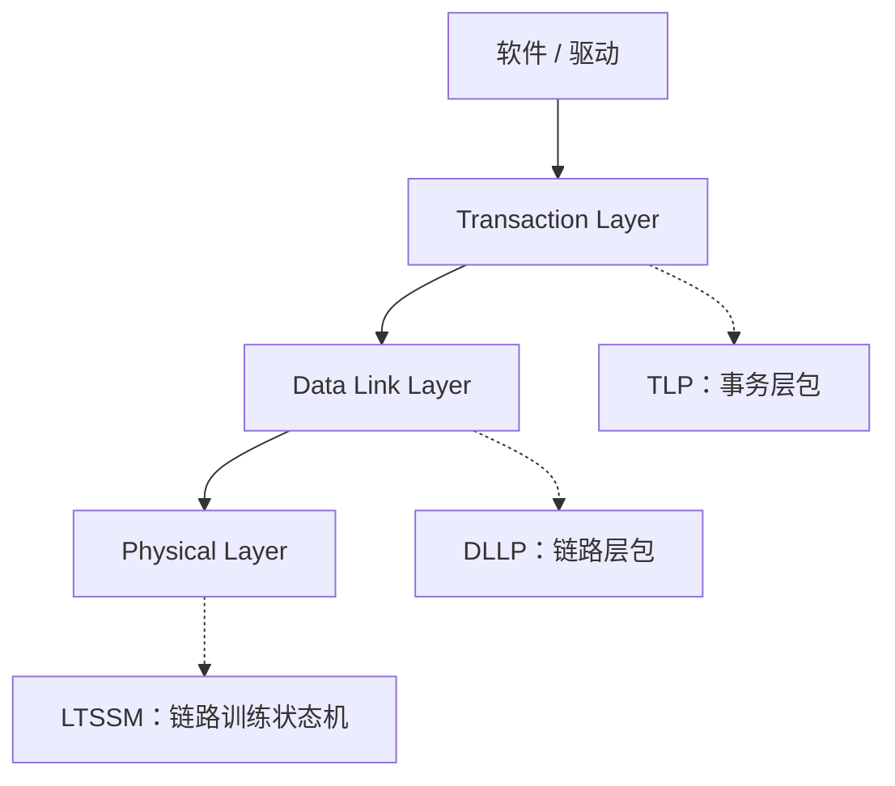
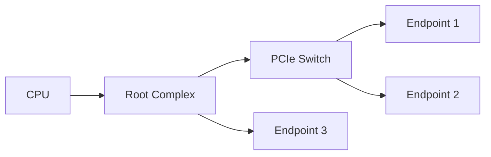
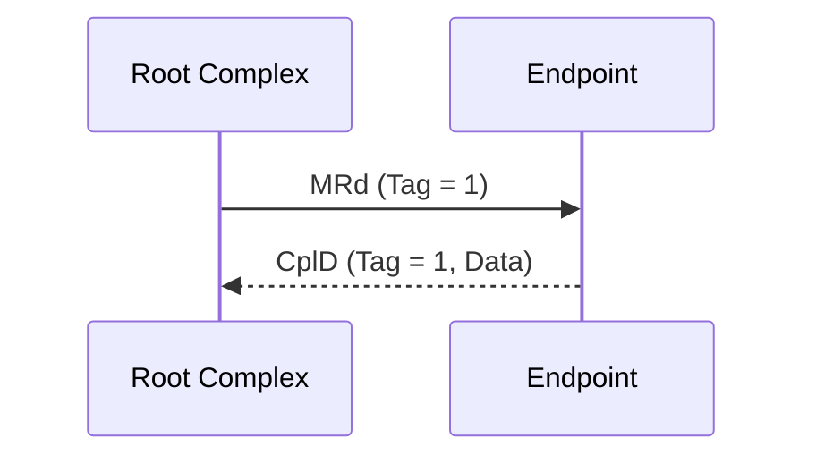
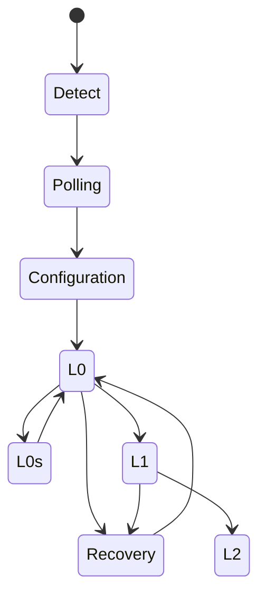

+++
title = "PCIe 协议入门：从分层架构到链路训练"
date = 2026-11-04
lastmod = 2026-11-04
draft = false
slug = "pcie-intro"
description = "从分层架构、TLP、配置空间到 LTSSM 链路训练，建立 PCIe 的整体知识框架，并给出设计与验证要点"
categories = ["总线与接口"]
tags = ["pcie", "tlp", "ltssm", "configuration-space"]
series = ["pcie-from-scratch"]
series_title = "PCIe 从零开始"
series_order = 10
math = true
toc = true
comments = true
keywords = ["PCIe", "TLP", "LTSSM", "配置空间", "链路训练", "BAR"]
+++

## TL;DR

PCIe（PCI Express）是**点对点、分组交换、分层**的高速串行互连。它把一次访问拆成 TLP（Transaction Layer Packet），经过数据链路层加序列号和 LCRC、物理层编码后，通过一条或多条 Lane 发送；接收端逐层解析，最终访问目标设备的配置空间或内存。

理解 PCIe 可以先抓住四条主线：

1. **分层**：Transaction / Data Link / Physical 三层各管什么。
2. **拓扑与枚举**：Root Complex、Switch、Endpoint 如何组成树，BDF 和 BAR 如何分配。
3. **事务**：MRd/MWr/CplD 等 TLP 的类型、路由、Tag 和完成匹配。
4. **链路**：LTSSM 如何把一条链路训练到 L0，以及链路错误如何恢复。

本文是系列的第 1 篇，目标是建立整体框架；电气特性、CXL、SR-IOV 等专题会单独展开。

## 背景：从共享总线到点对点串行链路

早期的 PCI 是共享并行总线：多个设备挂在同一组地址/数据线上，靠仲裁决定谁先使用总线。随着带宽需求上升，并行总线遇到几个问题：

- **引脚多、布线难**：32/64 位并行数据线加地址线，PCB 走线和时序收敛成本高。
- **共享带宽**：所有设备竞争同一组总线，频率提升后信号完整性问题更严重。
- **扩展性差**：设备数量增加会带来负载和反射问题。

PCIe 的思路是：

- 用**差分串行 Lane** 代替并行总线，降低引脚数、提高频率。
- 每条 Link 是**点对点**的，设备之间通过 Switch 转发，而不是共享同一组线。
- 用**分层协议**把事务、可靠传输和物理编码解耦。
- 通过**增加 Lane 数量**（x1/x2/x4/x8/x16）线性扩展带宽。

不同代的单 Lane 带宽大致如下（单向）：

| 代际 | 传输速率 | 编码 | 单 Lane 有效带宽（单向） |
| --- | --- | --- | --- |
| Gen1 | 2.5 GT/s | 8b/10b | ~250 MB/s |
| Gen2 | 5.0 GT/s | 8b/10b | ~500 MB/s |
| Gen3 | 8.0 GT/s | 128b/130b | ~985 MB/s |
| Gen4 | 16.0 GT/s | 128b/130b | ~1.97 GB/s |
| Gen5 | 32.0 GT/s | 128b/130b | ~3.94 GB/s |
| Gen6 | 64.0 GT/s | PAM4 + FEC | 约 8 GB/s 量级 |

有效带宽可以用下面的公式估算：

$$
\text{Per-lane bandwidth} = \text{Transfer Rate} \times \text{Encoding Efficiency} \div 8
$$

例如 Gen3 x16：

$$
8\,\text{GT/s} \times \frac{128}{130} \times 16 \div 8 \approx 15.75\,\text{GB/s}
$$

> 注意：这是单向、理想编码开销下的数字。实际吞吐还会受 TLP 头开销、流控、MPS、访问模式和对端能力影响。

## 分层架构

PCIe 从高到低分为三层，每层有明确的职责边界：



### Transaction Layer

事务层负责：

- 把软件/设备的访问请求转换成 **TLP**。
- 解析 TLP 头，决定路由方式（地址路由、ID 路由、消息路由）。
- 管理 **Tag** 和 **Outstanding**，把 Completion 匹配回原始请求。
- 维护 **流量控制（Flow Control）** 的信用计数。

### Data Link Layer

数据链路层负责**链路级的可靠传输**：

- 给 TLP 加上序列号和 LCRC。
- 用 ACK/NAK DLLP 确认或请求重传。
- 维护重传缓冲区（Replay Buffer）。
- 处理链路层的流控信用更新（InitFC/UpdateFC）和电源管理 DLLP。

DLLP 是**链路本地**的，不会被 Switch 转发；TLP 才会端到端路由。

### Physical Layer

物理层负责：

- 逻辑子层：编码/解码（Gen1/2 用 8b/10b，Gen3+ 用 128b/130b）、加扰、链路训练。
- 电气子层：SerDes、差分发送/接收、时钟恢复、均衡。
- **LTSSM**：链路训练和状态管理状态机。

对 SoC 设计者来说，Physical Layer 通常以 **PIPE 接口**的形式与 MAC/控制器对接，是集成时最需要关注的边界。

## 拓扑与枚举

PCIe 的拓扑是一棵树，不是共享总线：



- **Root Complex（RC）**：连接 CPU/内存与 PCIe 拓扑，通常包含一个或多个 Root Port。
- **Switch**：由一个 Upstream Port 和多个 Downstream Port 组成，内部是虚拟 PCI-to-PCI 桥，按总线号转发 TLP。
- **Endpoint（EP）**：真正的设备，使用 Type 0 配置空间头。
- **Bridge**：连接 PCIe 与旧总线（如 PCI/PCI-X）或扩展拓扑，使用 Type 1 头。

### BDF 与配置空间

每个 PCIe 功能用 **BDF** 寻址：

- Bus：8 bit
- Device：5 bit
- Function：3 bit

每个 Function 有 **4 KB 配置空间**，前 256 字节兼容传统 PCI，之后是 PCIe 扩展能力。常见字段：

| 偏移 | 字段 | 作用 |
| --- | --- | --- |
| 0x00 | Vendor ID / Device ID | 厂商标识和设备标识 |
| 0x04 | Command / Status | 使能 Memory/IO/Bus Master，查看状态 |
| 0x08 | Revision ID / Class Code | 设备类别 |
| 0x0C | Header Type 等 | Type 0 端点 / Type 1 桥 |
| 0x10–0x24 | BAR0–BAR5 | 地址空间基址寄存器 |
| 0x2C | Subsystem Vendor/ID | 子系统标识 |
| 0x34 | Capabilities Pointer | 能力链表入口 |
| 0x3C | Interrupt Line/Pin | 传统中断信息 |

### BAR 是怎么分配的

BAR（Base Address Register）告诉系统“这个设备需要多大的地址空间”。枚举时通常按以下步骤确定：

1. 保存 BAR 原值。
2. 向 BAR 写入全 1。
3. 读回 BAR，根据可写位和掩码推断空间大小、类型（Memory/IO、32/64 位、是否可预取）。
4. 恢复原值，再由系统分配实际基地址并写回。
5. 打开 Command 寄存器中的 Memory/IO 使能和 Bus Master。

这也是验证配置空间时最常写的用例之一。

### 枚举流程

系统启动后，Root Complex 从 Bus 0 开始扫描：

1. 读 Vendor ID；`0xFFFF` 表示该位置没有设备。
2. 读 Header Type，判断是端点还是桥。
3. 如果是桥，分配 Secondary/Subordinate Bus Number，继续扫描下游。
4. 为端点分配 BAR 地址空间。
5. 使能 Memory/IO 解码和 Bus Master。

Switch 内部的虚拟桥根据 Bus Number 决定 TLP 往哪个端口转发。

## TLP 与事务

TLP 是事务层的核心。一个 TLP 通常由**头（Header）**、可选**数据（Data）**和可选 **ECRC** 组成。

### 常见 TLP 类型

| TLP | Posted？ | 路由 | 典型用途 |
| --- | --- | --- | --- |
| Memory Read（MRd） | 否 | 地址 | 读内存，返回 CplD |
| Memory Write（MWr） | 是 | 地址 | 写内存，无完成 |
| I/O Read/Write | 否 | 地址 | 遗留 I/O 空间访问 |
| Config Read/Write Type 0 | 否 | ID | 访问端点配置空间 |
| Config Read/Write Type 1 | 否 | ID | 访问桥后配置空间 |
| Completion（Cpl/CplD） | 否 | ID | 完成响应 |
| Message（Msg） | 是 | 消息路由 | 中断、电源管理、错误 |

几个容易混淆的点：

- **Posted** 表示不需要 Completion。Memory Write 和 Message 是 posted；Memory Read、Config Read/Write 是 non-posted。
- **Config Write 是 non-posted**，不是 posted。
- Completion 用 **Requester ID + Tag** 匹配原始请求；Tag 位宽和 Outstanding 能力由设备能力决定。
- Memory 请求**不能跨 4 KB 边界**，跨边界的访问需要请求方拆分。
- **MPS（Max Payload Size）** 决定单个 TLP 的最大数据载荷（128–4096 字节）；**MRRS（Max Read Request Size）** 决定一次读请求的最大长度。

### TLP 交互示意



一次 Memory Read 的生命周期大致是：

1. 请求方发出 MRd，携带地址、长度、Requester ID 和 Tag。
2. 目标设备读内存，返回 CplD，携带相同 Requester ID 和 Tag。
3. 请求方根据 Tag 把 Completion 匹配回原始请求。
4. 如果超时没有收到 Completion，可能触发 Completion Timeout 错误。

## 链路训练与 LTSSM

链路不是上电就能传 TLP 的，需要先经过 **LTSSM（Link Training and Status State Machine）** 训练到 L0。



主要状态：

- **Detect**：检测对端接收器是否存在。
- **Polling**：发送/接收 TS1/TS2 有序集，建立位锁和符号锁。
- **Configuration**：协商链路宽度、Lane 反转、极性反转和速率，进入 L0。
- **L0**：正常工作状态，TLP/DLLP 可以传输。
- **Recovery**：链路出错、速率切换或重新训练时进入，恢复后回到 L0。
- **L0s / L1 / L2**：不同深度的低功耗状态；L2 需要辅助电源。

链路训练要处理的实际问题包括：

- **Lane 反转**：PCB 布线时 Lane 顺序可能反过来，训练阶段需要自动纠正。
- **极性反转**：差分对的 P/N 可能接反，训练阶段需要检测并纠正。
- **速率协商**：双方从共同支持的最高速率开始协商；Gen3+ 还涉及均衡（Equalization）。
- **Hot Reset**：通过链路训练触发对端的复位，不经过 PERST#。

### PIPE 接口示意

在 SoC 集成中，MAC/控制器与 PHY 之间通常使用 **PIPE** 接口。下面是一个简化的发送方向时序，帮助理解 `TxDataValid`、`TxElecIdle` 和 `PowerDown` 的关系：


{
  "signal": [
    {"name": "PCLK", "wave": "p........"},
    {"name": "TxDataValid", "wave": "0.1....0."},
    {"name": "TxData", "wave": "x.==.x...", "data": ["D0", "D1"]},
    {"name": "TxElecIdle", "wave": "1..0..1.."},
    {"name": "PowerDown", "wave": "2........", "data": ["P0"]}
  ],
  "config": {"hscale": 2}
}


> 上图只表达 PIPE 发送方向的信号关系，不代表完整的 PIPE 协议时序；实际设计要以对应版本的 PIPE 规范和 PHY 手册为准。

## 流量控制与错误处理

### 流控信用

PCIe 用**基于信用的流控**避免接收端缓冲区溢出：

- 按 **Posted（P）**、**Non-Posted（NP）**、**Completion（Cpl）** 分开管理。
- 每类又分 **Header Credit** 和 **Data Credit**；一个 Data Credit 通常代表 4 DW（16 字节）。
- 接收端通过 InitFC/UpdateFC DLLP 通告可用信用。
- 发送端只有确认信用足够时才发送 TLP，避免溢出。

流控解决的是“**不要发太快**”，不负责可靠传输；可靠传输由数据链路层的 ACK/NAK 和重传负责。

### 错误分类

PCIe 的错误通常分为：

- **Correctable**：可纠正，例如 LCRC 错误、Bad TLP、Replay Timer 超时。
- **Non-Fatal**：不可纠正但可以继续运行，例如 Unsupported Request（UR）、Completer Abort（CA）、Completion Timeout、Poisoned TLP。
- **Fatal**：链路或设备级严重错误，通常需要复位或隔离。

**AER（Advanced Error Reporting）** 是可选能力，提供更详细的错误状态、掩码和错误消息路由；Root Port 可以把错误上报给系统。**DPC（Downstream Port Containment）** 是另一个可选机制，用于在严重错误时隔离下游链路。

## 关键设计要点

### 控制器结构

一个典型的 PCIe 控制器/Endpoint 包含：

- **Transaction Layer**：TLP 组装/解析、Tag 管理、Outstanding 表、流控信用。
- **Data Link Layer**：序列号、LCRC、重传缓冲、ACK/NAK。
- **Physical Layer / PIPE**：与 SerDes/PHY 对接，处理链路训练和编码。
- **配置空间**：BAR、Command/Status、Capability 链表、AER、MSI/MSI-X。
- **DMA / 应用接口**：把 PCIe 事务转换成内部 AXI/AHB 等总线访问。

### 时钟与复位

- **REFCLK**：常见 100 MHz 参考时钟，可能带 SSC（扩频时钟）。
- **PCLK**：PIPE 接口时钟，频率与链路速率和 PIPE 位宽相关。
- **PERST#**：Fundamental Reset，复位整个设备。
- **Hot Reset**：通过链路训练触发，不依赖 PERST#。
- **FLR（Function Level Reset）**：只复位某个 Function，不影响整个设备。

跨时钟域的地方（PCLK、核心时钟、DMA 时钟）需要做 CDC 处理；复位释放也要考虑同步。

### 物理层集成

- Lane 数量、速率、PIPE 位宽要在架构阶段确定。
- 关注 Lane 反转、极性反转、去加重（De-emphasis）、均衡（Equalization）。
- Gen3+ 的链路训练包含均衡阶段，调试时需要能抓取 LTSSM 状态和均衡系数。
- 预留 compliance/test 模式，方便 PHY 和链路调试。

## 验证要点

PCIe 验证通常分为**链路层、事务层、配置空间、电源管理和错误处理**几个维度。

### 链路训练

- 所有支持的速率和宽度组合都能训练到 L0。
- Lane 反转、极性反转、Lane 数量降级（如 x16 链路只训练成 x8）。
- Recovery、Hot Reset、L0s/L1 进出。
- 训练失败后的行为：重试、降速、上报错误。

### 配置空间与枚举

- Vendor/Device ID、Revision、Class Code 正确。
- BAR  sizing：全 1 写入、读回掩码、64 位 BAR、Prefetchable 属性。
- Command/Status 的 Memory/IO/Bus Master 使能。
- Capability 链表：PCIe Capability、Power Management、MSI/MSI-X、AER、SR-IOV（如支持）。
- 枚举：Bus/Device/Function 扫描、桥的 Primary/Secondary/Subordinate Bus Number、资源分配。

### TLP 与事务

- Memory Read/Write、Config Read/Write、I/O Read/Write、Message。
- Completion 匹配：Requester ID + Tag、CplD 数据长度、状态码（SC/UR/CA）。
- Posted/Non-posted 的顺序和超时。
- 跨 4 KB 边界的请求拆分。
- Malformed TLP、Unsupported Request、Completer Abort、Poisoned TLP。
- MPS/MRRS 边界和非法值。

### 流控与数据链路

- 初始信用通告和 UpdateFC。
- Header/Data Credit 不溢出、不下溢。
- ACK/NAK、重传、重复 TLP 丢弃、序列号回绕。
- LCRC 错误注入和恢复。

### 电源管理与错误

- D0/D1/D3hot/D3cold 状态转换。
- L0s/L1/L2 进入和退出。
- PME、唤醒、PERST# 时序。
- AER 正确上报 Correctable/Non-Fatal/Fatal。
- Completion Timeout、DPC（如支持）。

### SVA 示例

下面只是示意性的断言，实际项目要按协议规范补全前置条件和时序窗口：

```systemverilog
// Completion 必须在对应请求发出之后出现
property p_cpl_after_req;
  @(posedge clk) disable iff (!rst_n)
  cpl_valid |-> req_sent;
endproperty

// 流控信用计数不能下溢
property p_credit_no_underflow;
  @(posedge clk) disable iff (!rst_n)
  (credit_ph >= 0) && (credit_pd >= 0) &&
  (credit_nph >= 0) && (credit_npd >= 0);
endproperty

// L0 之前不应有 TLP 事务
property p_tlp_only_in_l0;
  @(posedge clk) disable iff (!rst_n)
  tlp_valid |-> (ltssm_state == L0);
endproperty
```

### 覆盖率建议

- TLP 类型 × 路由方式 × 完成状态（SC/UR/CA）。
- 链路状态 × 速率 × 宽度 × Lane 反转/极性。
- 配置空间字段 × BAR 类型 × Capability。
- 流控信用边界 × 溢出/下溢 × 重传。
- 错误类型 × AER 上报路径。

## 常见坑 / 面试题

**Q1：PCIe 为什么是点对点，而不是像 PCI 那样共享总线？**

点对点链路避免多设备共享同一组线带来的负载、反射和仲裁开销，每条 Link 可以独立跑高速率；设备之间通过 Switch 转发，带宽更容易扩展。

**Q2：Posted 和 Non-Posted 的区别？Config Write 是哪一种？**

Posted 事务不需要 Completion，发送方发完即可；Non-Posted 需要 Completion 确认结果。Memory Write 和 Message 是 posted；Memory Read、Config Read/Write、I/O Read/Write 是 non-posted。

**Q3：BAR 是怎么确定大小的？**

向 BAR 写全 1，再读回；根据可写位和掩码推断空间大小和类型，然后恢复原值并由系统分配基地址。

**Q4：Completion 如何匹配到原始请求？**

Completion 携带原始请求的 Requester ID 和 Tag；请求方用这两个字段查找 Outstanding 表，把数据和状态返回给上层。

**Q5：DLLP 和 TLP 的区别？**

TLP 是事务层包，端到端路由，承载读写/配置/消息；DLLP 是数据链路层的链路本地包，用于 ACK/NAK、流控信用和电源管理，不会被 Switch 转发。

**Q6：L0s 和 L1 有什么区别？**

两者都是低功耗状态。L0s 是较浅、进出更快的低功耗状态；L1 更深，需要更长的退出延迟；L2 需要辅助电源，通常伴随主电源关闭。

**Q7：为什么 Gen3 用 128b/130b 而不是 8b/10b？**

8b/10b 有 20% 的编码开销；128b/130b 只增加约 1.5% 的开销，在更高速率下能显著提高有效带宽。Gen3 及以上采用 128b/130b（Gen6 进一步使用 PAM4 和 FEC）。

**Q8：4 KB 边界规则是什么？**

PCIe Memory 请求不能跨 4 KB 边界；如果一次访问会跨边界，请求方必须拆成多个 TLP。这样可以简化目标设备的地址译码和桥的实现。

**Q9：MPS 和 MRRS 有什么区别？**

MPS（Max Payload Size）限制单个 TLP 的最大数据载荷；MRRS（Max Read Request Size）限制一次 Memory Read 请求的最大长度。两者都在枚举时协商，且受链路两端能力约束。

**Q10：链路训练失败会发生什么？**

取决于失败阶段和实现：可能重试、降速、降宽、进入 Recovery，或者上报链路错误并保持不可用。调试时通常需要抓 LTSSM 状态、TS1/TS2 有序集和均衡结果。

## 参考规范

- PCI-SIG, *PCI Express Base Specification*（以 PCI-SIG 发布的最新版本为准，如 6.x）
- PCI-SIG, *PCI Express Card Electromechanical Specification (CEM)*
- Intel, *PHY Interface for the PCI Express Architecture (PIPE) Specification*
- PCI-SIG compliance test suite / checklist
- MindShare, *PCI Express Technology*（系统学习 PCIe 的经典参考书）

> 协议细节以官方规范为准；本文是入门框架，不替代规范原文。

## 相关文章

- [知识地图]()：按主题浏览全部内容
- [PCIe 从零开始系列]()：本系列的后续文章
- 后续计划：TLP 头字段详解、配置空间与 BAR 实战、LTSSM 调试、PCIe 验证环境搭建
